<p align="center">
  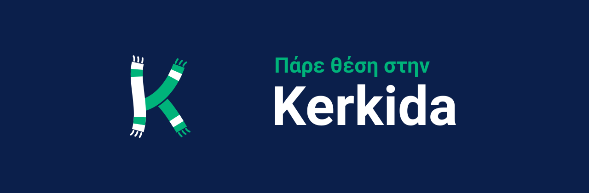
</p>

<p align="center">
  Αγώνες, μεταδόσεις, highlights, Fantasy και γήπεδα κοντά σου, σε μία εφαρμογή Android φτιαγμένη για τον Έλληνα φίλαθλο.
</p>

<p align="center">
  <a href="https://github.com/NikosAnat/kerkida-android/releases/latest"><strong>Κατέβασε το APK</strong></a> · <a href="https://nikosanat.github.io/kerkida-web/"><strong>Άνοιξε τη web έκδοση</strong></a>
</p>

<p align="center">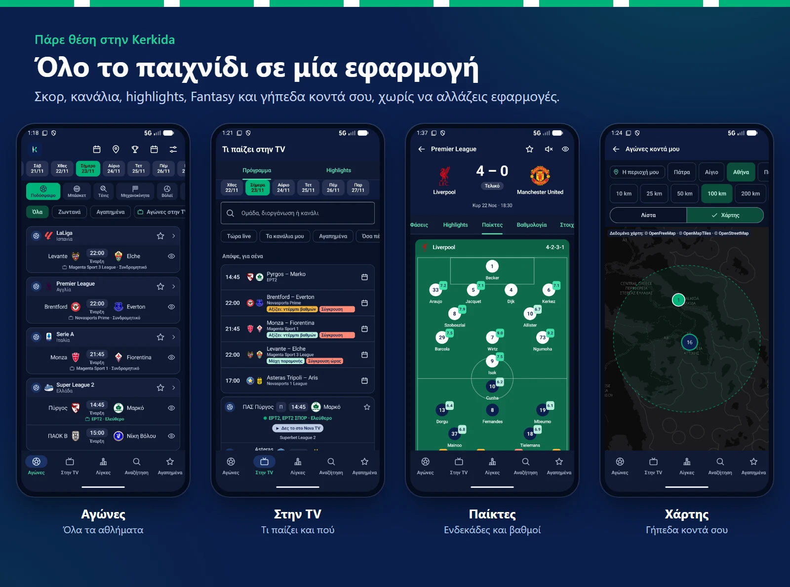</p>

## Γιατί Kerkida

Ο φίλαθλος στην Ελλάδα ανοίγει μία εφαρμογή για το σκορ, άλλη για το κανάλι, άλλη για τα highlights και άλλη για το Fantasy. Η Kerkida τα φέρνει σε ένα μέρος.

- **Ξέρεις πού παίζει.** Κάθε αγώνας δείχνει το ελληνικό κανάλι του, με προτεραιότητα στις συνδρομές σου.
- **Δεν σου χαλάει το ματς.** Με ένα πάτημα κρύβεις σκορ, φάσεις και ό,τι άλλο θα το αποκάλυπτε.
- **Βλέπεις τι παίζει δίπλα σου.** Ένας χάρτης δείχνει τα γήπεδα και τους αγώνες της περιοχής σου.
- **Ακολουθείς και το τοπικό.** Από τη Super League και τη Basket League έως μικρότερες κατηγορίες.
- **Βλέπεις τα highlights από επίσημες πηγές.** Novasports, Magenta, λίγκες, διοργανώσεις και σύλλογοι.

| | |
|---|---|
| Έκδοση | 1.0.0 |
| Πλατφόρμα | Android 8.0 και νεότερο (API 26+, target API 36) |
| Τεχνολογίες | Kotlin, Jetpack Compose, Material 3, Coroutines, WorkManager, OkHttp, Coil, MapLibre |
| Γλώσσες | Ελληνικά, Αγγλικά |
| Θέματα | Ανοιχτό, σκούρο, σύμφωνα με το σύστημα |

## Περιεχόμενα

- [Λειτουργίες](#λειτουργίες)
- [Πηγές δεδομένων](#πηγές-δεδομένων)
- [Απόρρητο](#απόρρητο)
- [Γνωστοί περιορισμοί](#γνωστοί-περιορισμοί)
- [Εκτέλεση και build](#εκτέλεση-και-build)
- [Δομή του κώδικα](#δομή-του-κώδικα)
- [Νομική σημείωση](#νομική-σημείωση)

## Λειτουργίες

### Αγώνες

<p align="center">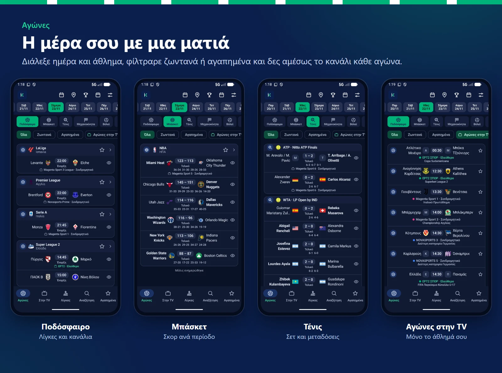</p>

- Ημερολογιακή λωρίδα με προηγούμενες και επόμενες ημέρες, καθώς και επιλογή οποιασδήποτε ημερομηνίας.
- Αθλήματα: ποδόσφαιρο, μπάσκετ, τένις, μηχανοκίνητα, βόλεϊ, ράγκμπι, αμερικανικό ποδόσφαιρο, χόκεϊ, μπέιζμπολ, μαχητικά αθλήματα, γκολφ, λακρός και αυστραλιανό ποδόσφαιρο, ανάλογα με όσα καλύπτουν οι επιλεγμένες λίγκες.
- Φίλτρα για όλους τους αγώνες, τους ζωντανούς, τα αγαπημένα και το πρόγραμμα TV του επιλεγμένου αθλήματος.
- Οι αγώνες εμφανίζονται σταδιακά, όσο απαντά κάθε πηγή, με ένδειξη προόδου.
- Αυτόματη ανανέωση όσο υπάρχουν αγώνες σε εξέλιξη και ανανέωση με σύρσιμο.
- Αποθήκευση απαντήσεων, ώστε τα τελευταία δεδομένα να εμφανίζονται και όταν η σύνδεση αποτυγχάνει.

### Σελίδα αγώνα

<p align="center">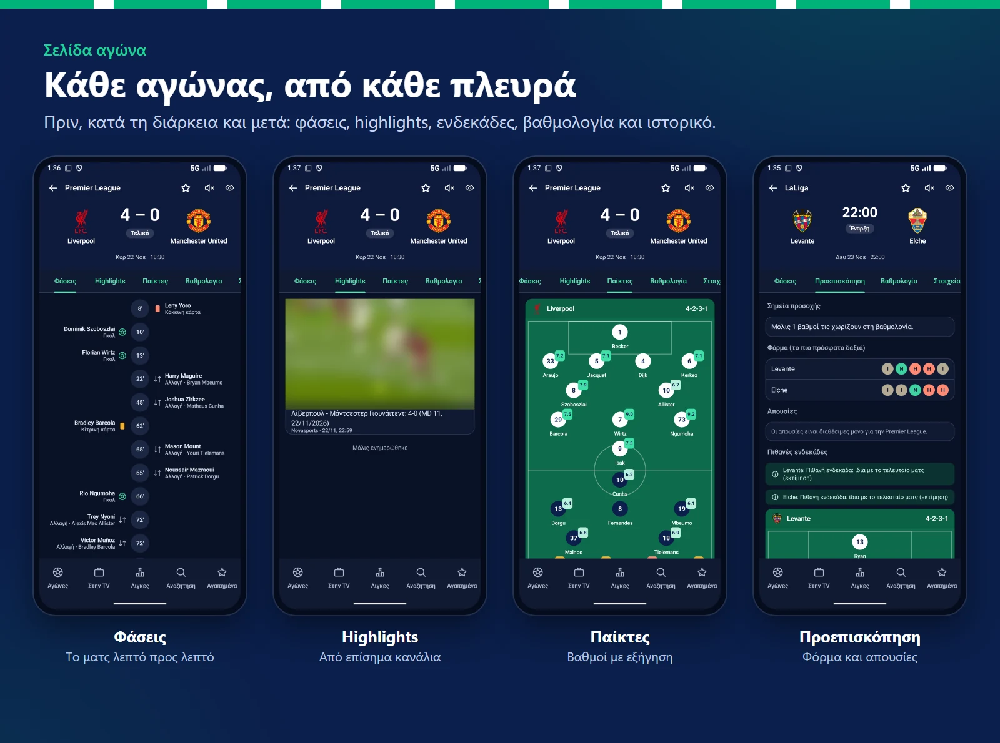</p>

<p align="center">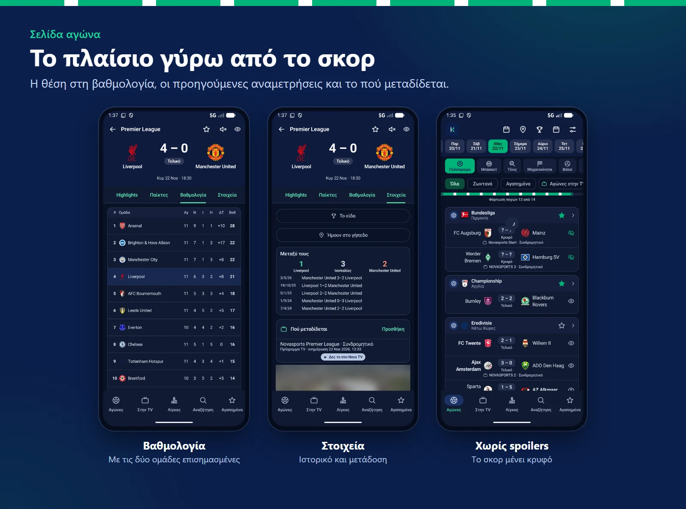</p>

- **Φάσεις:** γκολ, κάρτες, αλλαγές και άλλα γεγονότα, όπου τα δίνει η πηγή.
- **Highlights:** επίσημα βίντεο του αγώνα, όταν έχει τελειώσει και υπάρχουν διαθέσιμα.
- **Προεπισκόπηση:** φόρμα, απουσίες, πιθανή ενδεκάδα και βασικά σημεία για ποδοσφαιρικούς αγώνες.
- **Παίκτες:** ενδεκάδες σε γήπεδο, φωτογραφίες και βαθμολογίες με εξήγηση των ενεργειών πίσω από κάθε βαθμό.
- **Βαθμολογία** της διοργάνωσης, με επισημασμένες τις δύο ομάδες.
- **Στοιχεία:** γήπεδο, ιστορικό μεταξύ των ομάδων, «το είδα» και «ήμουν εκεί».

### Προστασία από spoilers

<p align="center">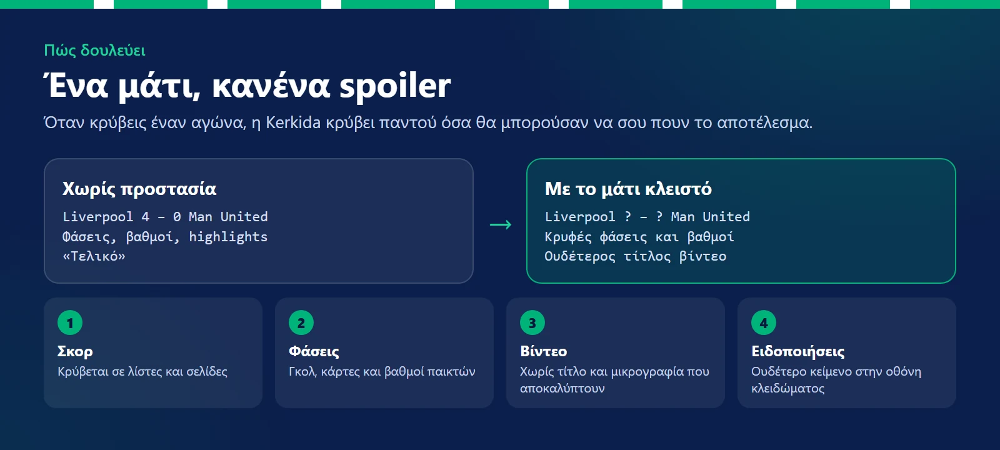</p>

- Το εικονίδιο του ματιού κρύβει σκορ και φάσεις ανά αγώνα.
- Η προστασία καλύπτει και άλλα σημεία που θα μπορούσαν να αποκαλύψουν το αποτέλεσμα, όπως τις μικρογραφίες και τους τίτλους των highlights και το ιστορικό των ομάδων.
- Υποστηρίζει και προβολή με καθυστέρηση, ώστε τα στατιστικά να μην προτρέχουν της εικόνας.

### Στην TV

<p align="center">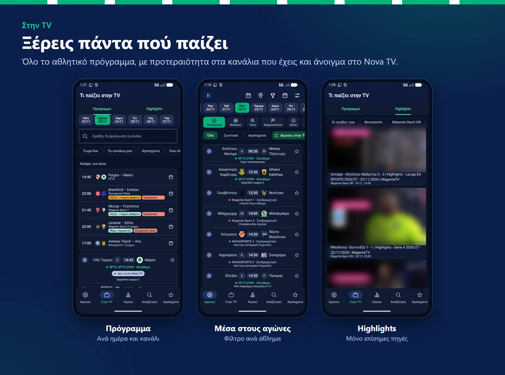</p>

<p align="center">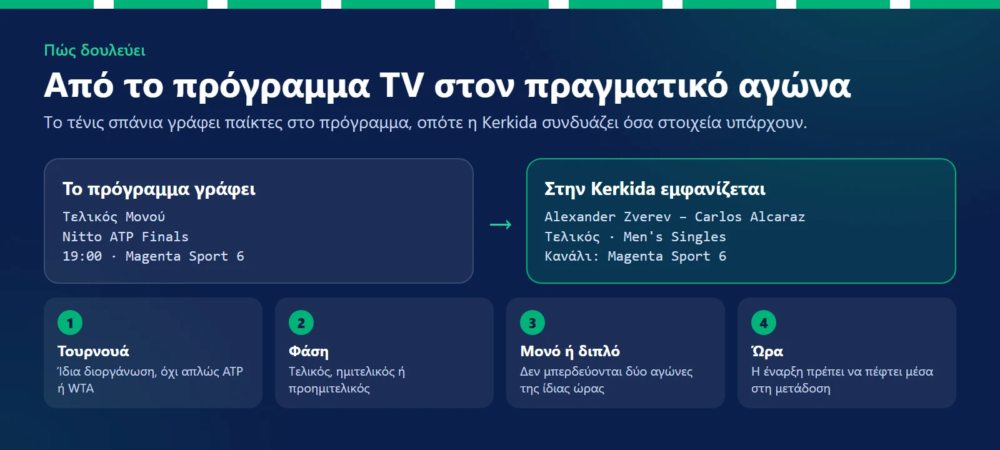</p>

- Πρόγραμμα αθλητικών μεταδόσεων για Novasports, Magenta Sport, ΕΡΤ, Eurosport, DAZN, ΑΝΤ1+, ΣΚΑΪ, Alpha, Star, Mega, Open και άλλα κανάλια.
- Αναζήτηση ανά ομάδα, διοργάνωση ή κανάλι, και φίλτρα για ζωντανά, τα κανάλια μου και αγαπημένα.
- Αντιστοίχιση μεταδόσεων με τους πραγματικούς αγώνες, και σε ελληνική και σε λατινική γραφή.
- Στο τένις η αντιστοίχιση γίνεται με επώνυμα ή με τουρνουά, φάση, μονό/διπλό και ώρα.
- Ενοποίηση διαφορετικών γραφών του ίδιου καναλιού, π.χ. `Magenta Sport 3 L` και `Magenta Sport 3 League`.
- Κατάταξη σύμφωνα με τις συνδρομές σου και προτάσεις για το τι αξίζει να δεις απόψε.
- Κουμπί **«Δες το στο Nova TV»** που ανοίγει το κανάλι στην επίσημη εφαρμογή. Η σύνδεση και η αναπαραγωγή γίνονται εκεί, με τη δική σου συνδρομή.
- Προσθήκη αγώνα στο ημερολόγιο του κινητού.

### Highlights

- Μόνο από επίσημα κανάλια: Novasports, Magenta Sport GR, Premier League, LALIGA, Serie A, Bundesliga, Ligue 1, UEFA, EuroLeague, NBA, Basketball Champions League, Formula 1, ATP, WTA, Ολυμπιακός, ΠΑΟΚ, ΑΕΚ και Άρης.
- Φίλτρα ανά πηγή και για τις ομάδες σου.
- Τα βίντεο ανοίγουν στην πηγή τους και δεν αντιγράφονται.
- Έλεγχος αθλήματος, ώστε ένα βίντεο μπάσκετ να μη συνδεθεί με ποδοσφαιρικό αγώνα των ίδιων συλλόγων.

### Λίγκες, ομάδες και αναζήτηση

<p align="center">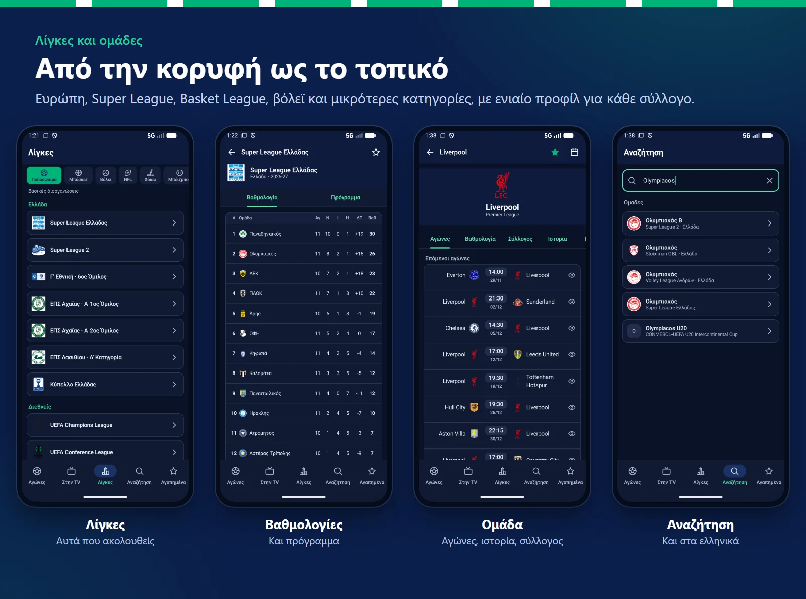</p>

- Κατάλογος 329 ποδοσφαιρικών διοργανώσεων, μαζί με διοργανώσεις άλλων αθλημάτων, και επιλογή όσων ακολουθείς.
- Βαθμολογίες και πρόγραμμα ανά αγωνιστική.
- Ελληνικές κατηγορίες: Super League, Super League 2, Γ΄ Εθνική, Basket League, Elite League, βόλεϊ ανδρών και γυναικών, και τοπικά πρωταθλήματα όπου υπάρχει πηγή.
- Ενιαίο προφίλ για τον ίδιο σύλλογο σε πρωτάθλημα, κύπελλο και Ευρώπη.
- Προφίλ συλλόγου με ιστορία, τίτλους, γήπεδο, πόλη και φωτογραφίες.
- Αναζήτηση ομάδων και λιγκών και στα ελληνικά.

### Αγώνες κοντά μου

<p align="center">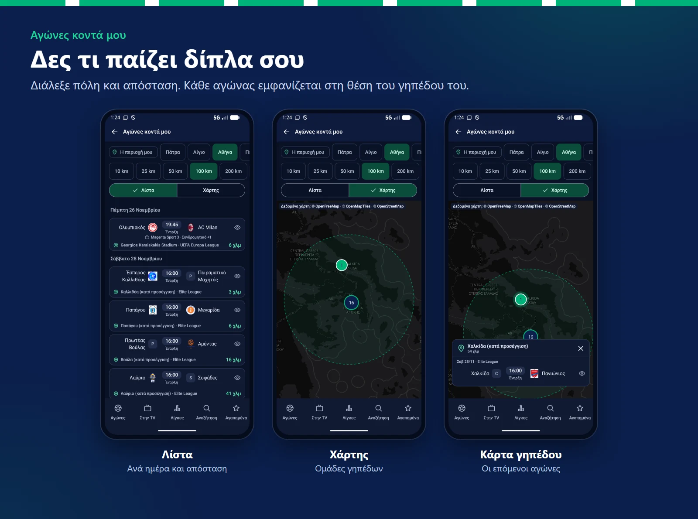</p>

- Χρήση της τοποθεσίας σου ή επιλογή ελληνικής πόλης, με ακτίνα από 10 έως 500 km.
- **Προβολή λίστας** ανά ημέρα, με γήπεδο και απόσταση.
- **Προβολή χάρτη** με ένα σημάδι ανά γήπεδο και τον αριθμό των αγώνων του.
- Τα κοντινά γήπεδα ομαδοποιούνται και ξεχωρίζουν με ζουμ.
- Κάρτα γηπέδου με τους επόμενους αγώνες και σύνδεση στη σελίδα κάθε αγώνα.
- Χάρτης σε ανοιχτό και σκούρο στυλ, με εμφανή την ακτίνα αναζήτησης.

### Προσωπικά εργαλεία

<p align="center">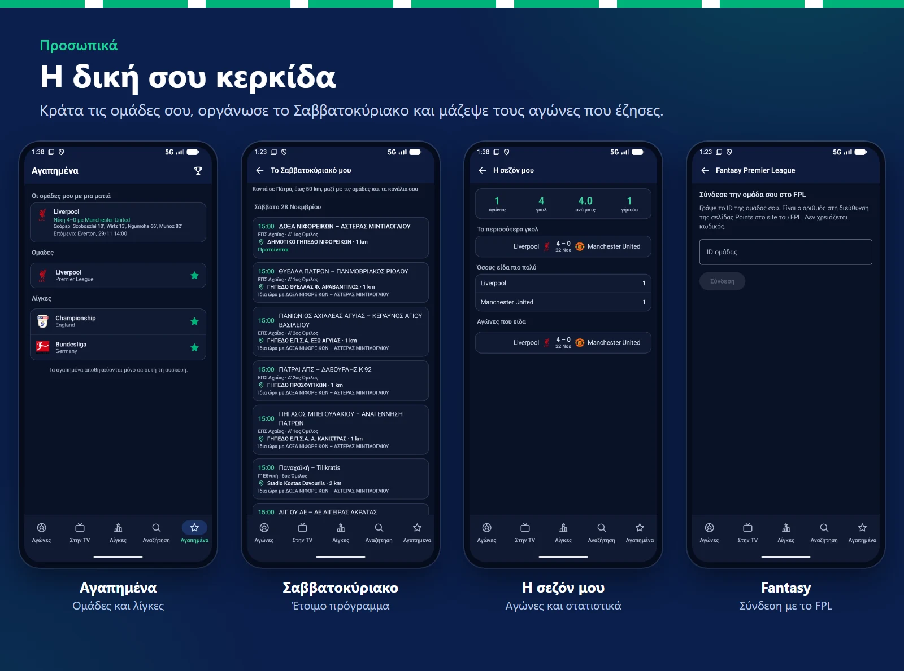</p>

- **Αγαπημένα** για ομάδες, λίγκες και αγώνες, με προσωπικό πίνακα.
- **Το Σαββατοκύριακό μου:** πρόταση προγράμματος με βάση ομάδες, κανάλια και αγώνες κοντά σου.
- **Η σεζόν μου:** καταγραφή αγώνων που είδες ή παρακολούθησες από κοντά.
- **Ημερολόγιο ομάδων:** ξεχωριστό ημερολόγιο Kerkida στο κινητό με το πρόγραμμα των ομάδων που διαλέγεις.

### Fantasy Premier League

- Σύνδεση με το ID της ομάδας σου.
- Ομάδα και ζωντανοί πόντοι.
- Mini-leagues με ζωντανή κατάταξη.
- Πληροφορίες και υπενθύμιση για το deadline.

### Ειδοποιήσεις

Είναι προαιρετικές και κλειστές αρχικά.

- Έξυπνες ειδοποιήσεις ανά ομάδα για κόκκινες κάρτες, γκολ στο τέλος και ανατροπές.
- «Αύριο παίζει κοντά σου».
- Σύνοψη της Δευτέρας για τις ομάδες σου.
- Υπενθύμιση Fantasy 24 και 2 ώρες πριν από το deadline.
- Στην οθόνη κλειδώματος εμφανίζεται ουδέτερο κείμενο, ώστε να μη φαίνεται αποτέλεσμα.

### Εμφάνιση και εμπειρία

<p align="center">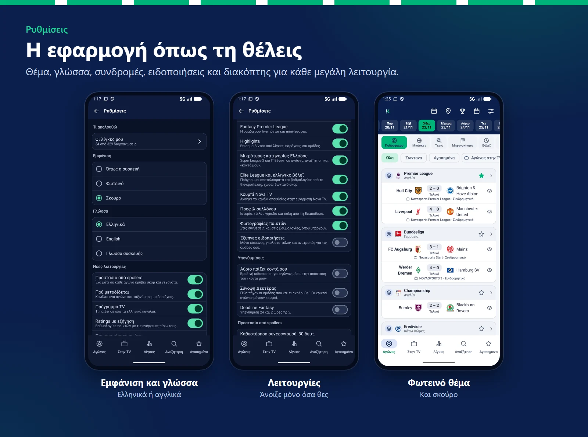</p>

- Προσαρμογή σε μεγάλο μέγεθος κειμένου, μικρές οθόνες και οριζόντια προβολή.
- Ρυθμίσεις για θέμα, γλώσσα, πηγή δεδομένων, συνδρομές, λίγκες και ενεργοποίηση ή απενεργοποίηση κάθε μεγάλης λειτουργίας.
- Λειτουργία demo με δοκιμαστικά δεδομένα.

## Πηγές δεδομένων

<p align="center">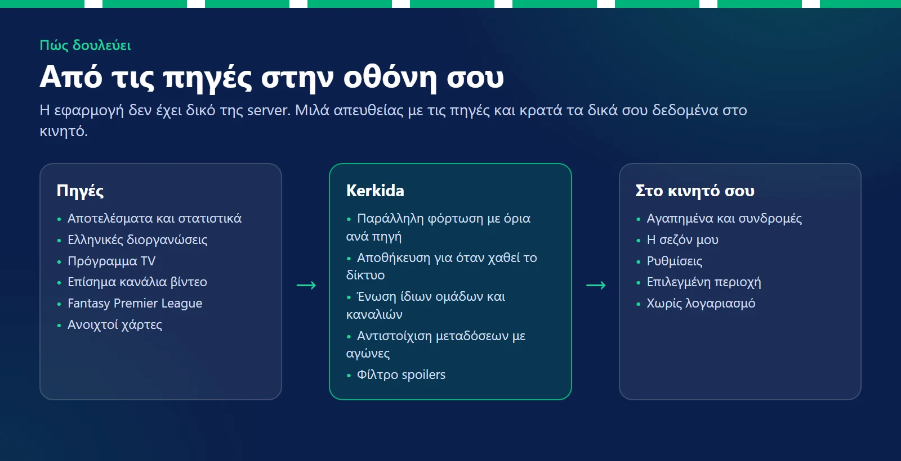</p>

| Χρήση | Πηγή |
|---|---|
| Αγώνες, ενδεκάδες, στατιστικά, βαθμολογίες | ESPN (ανεπίσημα public endpoints) |
| Εναλλακτική πηγή αγώνων | TheSportsDB |
| EuroLeague και EuroCup | Feed της διοργάνωσης |
| Ελληνική Basket League | esake.gr |
| Elite League και ελληνικό βόλεϊ | the-sports.org |
| Fantasy και επίσημες φωτογραφίες Premier League | Fantasy Premier League |
| Φωτογραφίες άλλων παικτών | Wikidata και Wikimedia Commons |
| Πρόγραμμα TV | ΣΠΟΡ FM και κοινοτικός οδηγός XMLTV |
| Highlights | RSS των επίσημων καναλιών YouTube |
| Προφίλ συλλόγων | Wikipedia |
| Χάρτης | OpenFreeMap, OpenMapTiles, OpenStreetMap |

Χάρτης: © OpenFreeMap, © OpenMapTiles, © [OpenStreetMap contributors](https://www.openstreetmap.org/copyright).

## Απόρρητο

- Η εφαρμογή δεν έχει λογαριασμούς χρηστών ούτε δικό της server.
- Αγαπημένα, ρυθμίσεις, συνδρομές και ιστορικό μένουν στο κινητό.
- Η τοποθεσία χρησιμοποιείται κατά προσέγγιση, μόνο όταν τη ζητήσεις, και η Kerkida δεν την αποθηκεύει ούτε τη μοιράζεται. Αποθηκεύεται μόνο η επιλεγμένη περιοχή για το «Κοντά μου».
- Η προβολή χάρτη κατεβάζει εικόνες της περιοχής από το OpenFreeMap, άρα ο server βλέπει ποια περιοχή εμφανίζεται.
- Κάθε εξωτερική πηγή λαμβάνει τα συνηθισμένα στοιχεία ενός αιτήματος δικτύου, όπως τη διεύθυνση IP.

## Γνωστοί περιορισμοί

- Δεν είναι όλα τα δεδομένα ζωντανά ή πλήρη, και η κάλυψη εξαρτάται από κάθε πηγή.
- Οι περισσότερες πηγές είναι ανεπίσημες ή χωρίς εγγύηση και μπορεί να αλλάξουν χωρίς προειδοποίηση.
- Η πρώτη ημερήσια φόρτωση του ελληνικού μπάσκετ διαρκεί περίπου 45 δευτερόλεπτα, γιατί οι αιτήσεις γίνονται με αργό ρυθμό.
- Τα πρόσωπα καλύπτουν περίπου 9 στους 10 παίκτες στην Premier League και περίπου 2 με 3 στους 10 στις άλλες λίγκες.
- Τα highlights καλύπτουν κυρίως πρόσφατους αγώνες, γιατί κάθε κανάλι δίνει τα 15 τελευταία βίντεό του.
- Το Davis Cup εμφανίζεται στο πρόγραμμα TV αλλά όχι ως αγώνες, γιατί δεν υπάρχει στην πηγή αποτελεσμάτων.
- Για EuroCup και ελληνική Basket League δεν έχει προστεθεί κανάλι highlights.
- Ορισμένα μικρά γήπεδα έχουν μόνο τη θέση της πόλης και σημειώνονται ως «κατά προσέγγιση».
- Το κουμπί Nova TV ανοίγει το ίδιο κανάλι για τα `Magenta Sport N` και `Magenta Sport N League`, και η αντιστοίχιση αυτή δεν έχει επιβεβαιωθεί με ενεργή συνδρομή.
- Το universal APK είναι περίπου 49 MB, κυρίως λόγω της μηχανής του χάρτη.

## Εκτέλεση και build

Απαιτούνται Android Studio ή Android SDK 36 και JDK 17.

```bash
# Debug APK
./gradlew assembleDebug

# Εγκατάσταση σε συνδεδεμένη συσκευή ή emulator
./gradlew installDebug

# Unit tests
./gradlew testDebugUnitTest

# Release APK
./gradlew assembleRelease
```

Στα Windows χρησιμοποίησε `gradlew.bat`. Τα APK δημιουργούνται στο `app/build/outputs/apk/`.

### Υπογραφή release

Το κλειδί υπογραφής **δεν βρίσκεται στο αποθετήριο**. Το build διαβάζει το `../signing/keystore.properties`, δηλαδή έναν φάκελο δίπλα στο repository:

```properties
storeFile=kerkida-release.jks
storePassword=...
keyAlias=...
keyPassword=...
```

Αν το αρχείο λείπει, το release build βγαίνει χωρίς υπογραφή.

## Δομή του κώδικα

```text
app/src/main/java/app/kerkida/
├── alerts/       Έξυπνες ειδοποιήσεις
├── assistant/    Ημερήσιες υπενθυμίσεις και σύνοψη
├── broadcast/    Κανάλια, συνδρομές και σύνδεση με Nova TV
├── calendar/     Ημερολόγιο ομάδων
├── data/         Πάροχοι δεδομένων, μοντέλα, δίκτυο και cache
│   ├── club/         Προφίλ συλλόγων
│   ├── demo/         Δοκιμαστικά δεδομένα
│   ├── espn/         ESPN και άλλα αθλήματα
│   ├── greek/        Ελληνικές και τοπικές διοργανώσεις
│   ├── net/          Cache και όρια αιτήσεων
│   ├── photos/       Πρόσωπα παικτών και preload
│   └── thesportsdb/  TheSportsDB
├── fantasy/      Fantasy Premier League και βαθμολογίες
├── features/     Διακόπτες λειτουργιών
├── highlights/   Επίσημα βίντεο
├── nearby/       Αποστάσεις και λογική χάρτη
├── planner/      Σαββατοκύριακο
├── preview/      Προεπισκόπηση αγώνα
├── season/       Η σεζόν μου
├── shield/       Προστασία από spoilers
├── stadium/      Γήπεδα και τοποθεσίες
├── tv/           Πρόγραμμα και αντιστοίχιση μεταδόσεων
└── ui/           Οθόνες Jetpack Compose
```

Τα έτοιμα δεδομένα της εφαρμογής βρίσκονται στο `app/src/main/assets/`. Τα βοηθητικά scripts που παράγουν μέρος τους δεν περιλαμβάνονται στο αποθετήριο.

## Νομική σημείωση

Τα σήματα στα screenshots ανήκουν στους συλλόγους και τις διοργανώσεις και εμφανίζονται μόνο για αναγνώριση. Οι φωτογραφίες παικτών έχουν αφαιρεθεί και οι μικρογραφίες βίντεο είναι θολωμένες.

Η Kerkida είναι ανεξάρτητο έργο και **δεν συνδέεται, δεν χορηγείται και δεν εγκρίνεται** από λίγκες, ομοσπονδίες, συλλόγους, τηλεοπτικούς παρόχους ή τις πηγές δεδομένων που αναφέρονται εδώ.

- Ονόματα, σήματα και λογότυπα ανήκουν στους κατόχους τους και χρησιμοποιούνται μόνο για την αναγνώριση ομάδων, διοργανώσεων και καναλιών.
- Η εφαρμογή **δεν μεταδίδει και δεν αντιγράφει** αγώνες ή βίντεο. Παραπέμπει στις επίσημες εφαρμογές και τα επίσημα κανάλια.
- Τα δεδομένα παρέχονται χωρίς εγγύηση ακρίβειας ή διαθεσιμότητας.

© Kerkida. Με επιφύλαξη παντός δικαιώματος. Ο κώδικας δεν διατίθεται προς το παρόν με άδεια ανοιχτού λογισμικού.
